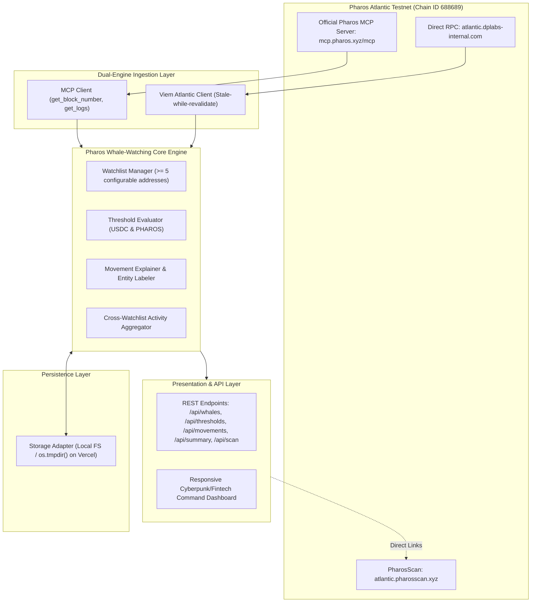

# 🐋 Pharos Whale-Watching Agent

An autonomous capital-flow monitoring agent for the **Pharos Atlantic Testnet (Chain ID 688689)**, built for the **Pharos Agent Arena** and integrated with the official **Pharos MCP Server** (`mcp.pharos.xyz/mcp`).


---

## 🎯 Verification of Official Scoring Criteria

| Criteria Code | Official Requirement | Implementation Status & Verification |
| :--- | :--- | :--- |
| **01** | Tracks at least 5 configurable addresses | **Verified**: Dynamic Watchlist Manager in `src/db/storage.ts` pre-seeded with 5 active Pharos Atlantic entities. Rejects malformed addresses and strictly enforces `>= 5` active accounts. |
| **02** | Configurable "significant" threshold per token or in value terms | **Verified**: Threshold Evaluator in `src/services/evaluator.ts` supports token-level minimums (USDC, PHAROS) and USD equivalent valuations with proper decimal scaling (6 decimals for USDC, 18 for PHAROS). |
| **03** | Each report explains the move (what moved, how much, where to, labeled where known, explorer tx link) | **Verified**: Semantic Movement Explainer formats contextual narrative reports with flow direction (`INFLOW` / `OUTFLOW` / `INTERNAL`), amount, counterparty labels, and direct [PharosScan](https://atlantic.pharosscan.xyz) links. |
| **04** | Produces a summary view of recent activity across all watched addresses | **Verified**: Cross-Watchlist Aggregator in `/api/summary` compiles total capital moved, net inflow/outflow per whale, top active whales, and top counterparties. |

---

## ⚡ Architecture & Dual Ingestion Engine



---

## 🚀 Quickstart & Local Execution

### 1. Prerequisites
- **Node.js**: `v20+` or `v24+`
- **npm**: `v10+`

### 2. Installation
```bash
git clone https://github.com/JimmyOgb/pharos-whalewatch-agent.git
cd pharos-whalewatch-agent
npm install
```

### 3. Build & Test
```bash
# Run automated verification suite (all 14 tests)
npm test

# Build production TypeScript bundles
npm run build
```

### 4. Run Locally
```bash
npm start
# Open http://localhost:3000
```

---

## 📡 REST API Reference

- `GET /api/summary`: Returns the cross-watchlist capital flow summary view (Requirement 04).
- `GET /api/movements`: Returns paginated whale movement feed with semantic explanations and PharosScan links (Requirement 03).
- `GET /api/whales`: Returns the active watchlist (Requirement 01).
- `POST /api/whales`: Adds a new whale address to the watchlist.
- `DELETE /api/whales/:id`: Removes a whale (enforces `>= 5` active addresses).
- `GET /api/thresholds`: Returns active significance thresholds (Requirement 02).
- `PUT /api/thresholds/:id`: Updates minimum token or USD thresholds.
- `POST /api/scan`: Triggers an on-demand scan of recent Atlantic Testnet blocks.
- `GET /api/telemetry`: Real-time system health, latest block height, and MCP server status.

---

## 🛡️ License
MIT License. Copyright (c) 2026 JimmyOgb.
