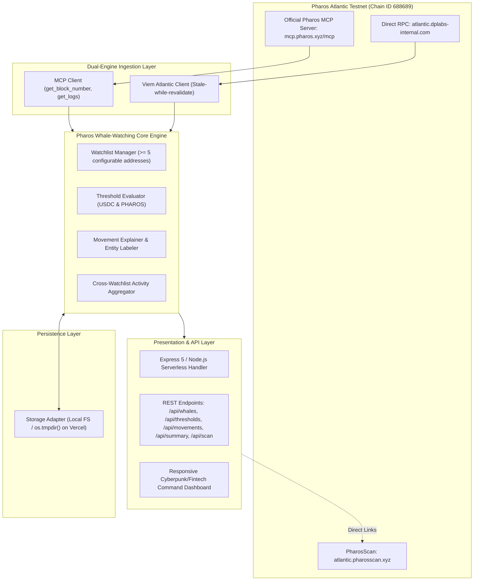

# Technical Feasibility & Architecture Audit

## 1. System Architecture Overview

## 2. Serverless & Cloud Resilience Safeguards
Based on lessons learned from high-load serverless environments:
1. **Bounded Execution**: Every network call (MCP or RPC) has an aggressive `AbortController` timeout (4.5s) to stay safely beneath Vercel's execution limits.
2. **In-Memory Block & Log Cache**: Reduces redundant upstream queries when multiple dashboard clients or pollers request telemetry simultaneously.
3. **Safe Storage Fallback**: Automatic directory resolution using `process.env.VERCEL ? os.tmpdir() : dataDir` ensures zero read-only filesystem errors (`EROFS`).
4. **Self-Paced UI Polling**: The frontend uses recursive `setTimeout` with `isPolling` guards and 5-second backoff rather than unbounded `setInterval`, preventing browser connection saturation.

## 3. Decimal Precision & Value Calculations
- **Atlantic Test USDC**: 6 decimals.
- **Native PHAROS**: 18 decimals.
- BigInt math handles raw wei / atomic units without precision loss before converting to human-readable strings with fixed decimal places.
